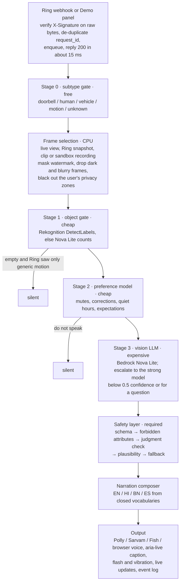
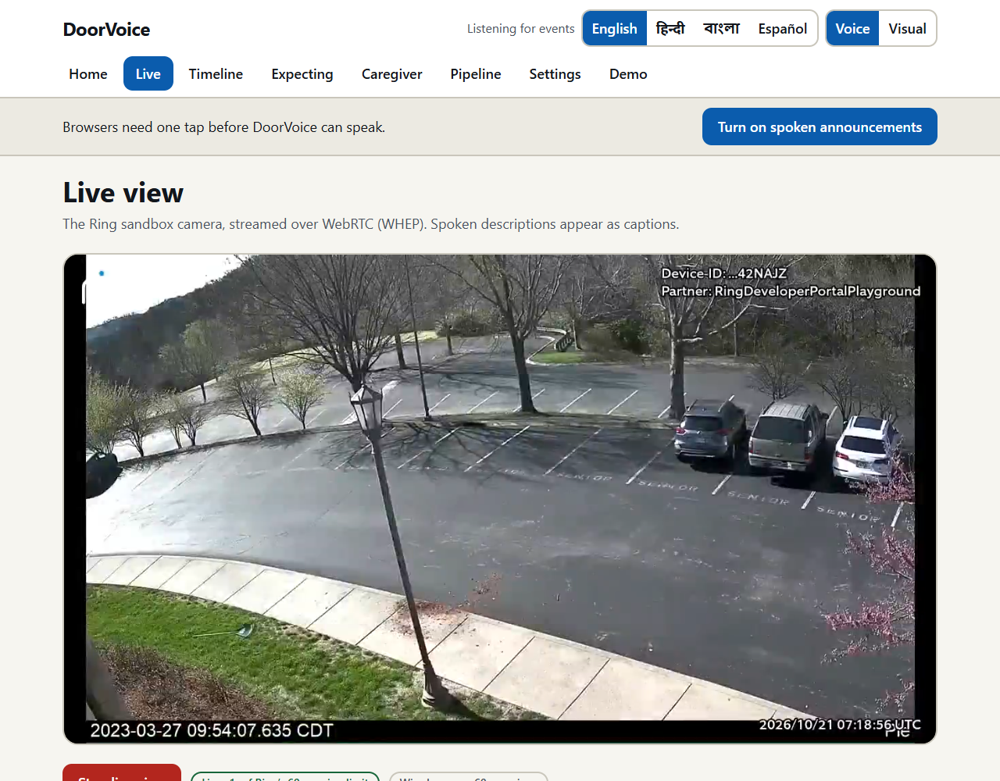
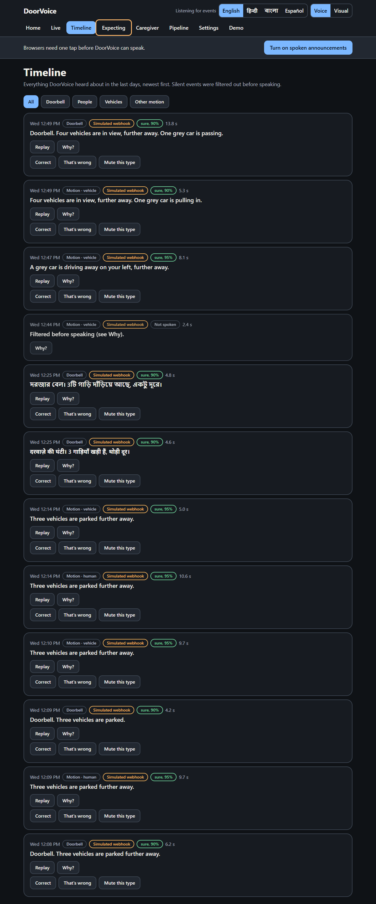
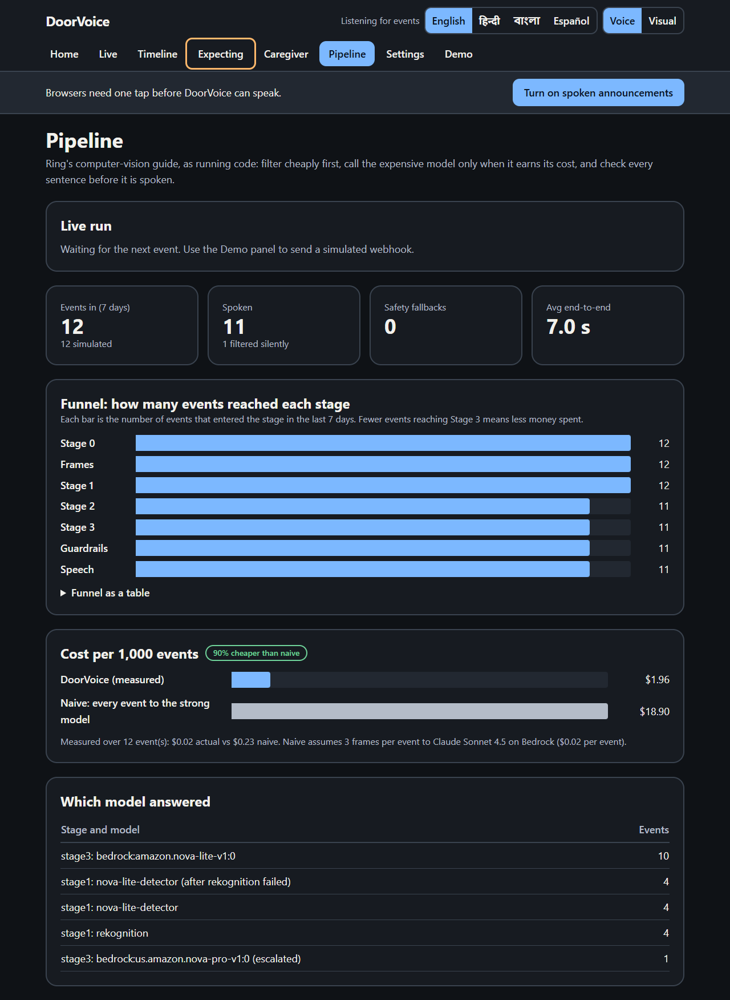

# DoorVoice

**A spoken, safety-checked guide to what is at your Ring door, for people who are blind, have low vision, are deaf or hard of hearing, or look after a relative from a distance.**

DoorVoice listens to Ring doorbell and motion events and says, in plain speech and in the user's language, *what* is at the door and *where*:

> "Doorbell. Four vehicles are in view, further away. One grey car is pulling in."
> *(a real announcement from the Ring Developer Playground sandbox, 21 Oct 2026)*

You can ask it questions about the live view by voice ("Is the car still there?", "Read the label"). It **never identifies people**: no faces, no names, no race, gender, age beyond child/adult, religion, disability or intent ("suspicious"). Every model output passes a tested safety layer before anything is spoken or shown.

It is built the way Ring's computer-vision guidance recommends: a tiered pipeline that filters cheaply first and calls the expensive vision model only when an event earns it.

Built for the Ring track of the Amazon *Build, Ship, Shape* Developer Hackathon, with the AWS Builder and Open Source mini-challenges. Licence: MIT.

---

## Contents

1. [What it does](#what-it-does)
2. [Quick start](#quick-start)
3. [Using the app](#using-the-app)
4. [How it works](#how-it-works)
5. [Safety layer](#safety-layer)
6. [Accessibility](#accessibility)
7. [AWS services](#aws-services)
8. [Ring APIs used](#ring-apis-used)
9. [Results](#results)
10. [Tests](#tests)
11. [Repository layout](#repository-layout)
12. [Known limitations](#known-limitations)
13. [Attribution](#attribution)

---

## What it does

| Feature | What is built |
|---|---|
| **Spoken door narration** | On a doorbell press or motion event, one spatial sentence of at most 25 words: count, object, action, position (left / centre / right, near / far). Wording follows confidence: 0.8 or more is stated plainly, 0.5–0.8 starts with "Looks like…", below 0.5 says "I can't tell what it is yet". |
| **Ask the Door** | Push-to-talk (Alt+T) or typed questions. A small classifier routes cheap questions ("Is anyone still there?") to the object detector only, sends "What are they holding?", "Read the label" and "Describe everything" to the vision model, and refuses identity questions ("Who is it?") before any model is called. |
| **Voice commands** | Control the whole app by voice from any screen (Alt+V or the **Voice command** button): "press doorbell press", "go to settings", "switch to Hindi", "make it flash instead of talking", "help". Common phrasings are matched by rules instantly; other sentences, in any of the four languages ("could you open the settings for me", "घंटी बजाओ"), are mapped by Amazon Nova Micro onto the buttons actually on screen. The model can only choose a real button, page, language or mode; feedback is built from the real button name. |
| **Safety layer** | A pure, unit-tested `guard()` function with five layers (schema, forbidden attributes, judgment check, plausibility, fallback). Every announcement has a **Why did it say that?** panel showing each stage, what was filtered, the confidence and any suppressed output. |
| **Four languages** | English, Hindi, Bengali and Spanish. The vision model emits language-neutral JSON from closed vocabularies; each language is rendered from fixed word lists, so no unchecked model text is ever translated. Voices: Amazon Polly, then Sarvam (Hindi/Bengali), Fish Audio, then the browser voice. |
| **"I'm expecting…"** | "A grocery delivery and my sister around 5" becomes structured expectations (delivery type, vehicle colour, time window). Events are matched by objects, vehicles and time, never by who a person is. |
| **Correction loop** | **Correct / That's wrong / Mute this type** on every announcement. Each tap stores a crop, the model output and the label (`source: user_feedback`). The preference stage uses it on the very next event; a nightly job exports a labelled dataset (local folder or S3). |
| **Caregiver mode** | A text-only "While you were out" digest from Ring event history plus DoorVoice's own descriptions, with an optional "no activity for N hours" line and a private share link. No pictures or video are shared. |
| **Deaf / hard-of-hearing mode** | "Visual" mode replaces speech with a full-screen colour flash per event type, a large caption, phone vibration and a persistent on-screen transcript. |
| **Screen-reader-first UI** | Landmarks, an `aria-live` mirror of every announcement, full keyboard use, focus moved to each page heading, reduced motion, and a layout that reflows at 200% text size. |
| **Pipeline visualiser** | Shows each event moving through every stage with latency, model, confidence and cost, plus a 7-day funnel and measured cost against sending every event to the strong model. |
| **Demo panel** | Sends HMAC-signed, byte-exact Ring webhook payloads through the real webhook route, replays them to show idempotency, and feeds judgmental sample outputs through the live safety layer. Everything it produces is labelled **Simulated**. |

## Quick start

**You need:** Node.js 18.18 or newer (20 LTS recommended), `ffmpeg` on your `PATH`, Ring app credentials from the Ring Developer Portal, and (recommended) AWS keys with Bedrock access.

```bash
git clone https://github.com/DevDaring/Amazon_Ring_Competition.git doorvoice
cd doorvoice
cp .env.example .env      # then fill in the keys described below
npm install               # also generates the database client
npm run dev               # creates data/doorvoice.db and serves http://localhost:3000
```

Or with Docker: `docker compose up` (Node 20 + ffmpeg image; `./data` is kept on the host).

### Keys in `.env`

| Key | Needed for |
|---|---|
| `RING_CLIENT_ID`, `RING_CLIENT_SECRET`, `RING_HMAC_KEY` | **Required.** From your app in the Ring Developer Portal. The server refuses to start without them. `RING_HMAC_KEY` verifies webhook signatures. |
| `RING_SANDBOX_TOKEN` | A temporary token from the Ring Developer Playground. Tokens last about 30 minutes; you can also paste a fresh one in **Settings** while the app runs. The browser never receives a Ring token. |
| `AWS_ACCESS_KEY_ID`, `AWS_SECRET_ACCESS_KEY`, `AWS_REGION` | Bedrock, Rekognition, Polly, Transcribe (see [AWS services](#aws-services) for the IAM policy). |
| `BEDROCK_MODEL_FAST`, `BEDROCK_MODEL_STRONG` | Vision models. Default fast tier `amazon.nova-lite-v1:0`; we ran the strong tier with `us.amazon.nova-pro-v1:0`. Any Bedrock vision model ID works, including Claude models once their Marketplace subscription is active. |
| `BEDROCK_GUARDRAIL_ID` | Optional. If set, Bedrock Guardrails run as the judgment check; otherwise Nova Micro answers a strict YES/NO question. |
| `OPENROUTER_API_KEY`, `OPENAI_API_KEY`, `SARVAM_API_KEY`, `FISH_AUDIO_API_KEY` | Optional fallbacks, used only when an AWS call fails. Comma-separated keys rotate round-robin. |
| `PUBLIC_WEBHOOK_URL` | An HTTPS URL (for example an ngrok tunnel) that forwards to `/api/ring/webhook`, if you want Ring to deliver real webhooks. |
| `DEMO_MODE` | `true` shows the Demo panel. |

`.env.example` lists every key with a short comment.

### Live demo

A hosted copy runs at **https://doorvoice.koushikdeb.com**. The site is password-protected because it calls paid AWS services; judges receive the login in the Devpost testing instructions. Ring's webhook URL, the account-link page and caregiver digest links stay reachable without it.

### Deploying on your own server

```bash
git clone https://github.com/DevDaring/Amazon_Ring_Competition.git doorvoice && cd doorvoice
cp .env.example .env    # fill in keys; set APP_BASE_URL and PUBLIC_WEBHOOK_URL to your https address
docker compose -f deploy/docker-compose.prod.yml up -d --build   # listens on 127.0.0.1:8190 only
```

Put a reverse proxy with HTTPS in front; `deploy/Caddyfile.example` shows the Caddy site block, including the password and the paths that must stay public.

## Using the app

1. Open **Settings → Ring connection** and paste a fresh Playground token. Home should read "Watching Playground Device".
2. Press **Turn on spoken announcements** once (browsers block sound until you interact).
3. Open **Live → Start live view**. The Ring sandbox camera streams over WebRTC; while it plays, the browser gives the server a frame every 2 seconds.
4. Open **Demo** and press **Doorbell press** or **Motion: vehicle**. The signed payload goes through the real webhook route, and the announcement is spoken, captioned and logged, labelled **Simulated webhook**.
5. Ask "Is the car still there?" or "Who is it?" on Home. Add an expectation, tap **That's wrong**, switch to **Visual** mode, open **Pipeline**, and run the **Guardrail test** samples on the Demo page.

Keyboard: Alt+S turn on sound, Alt+V voice command, Alt+1…8 switch screens, Alt+T push-to-talk, Alt+R replay the last announcement, Alt+W open "Why did it say that?".

## How it works



Details worth knowing:

- **Webhook first, work later.** The receiver verifies `X-Signature: sha256=<hex>` (HMAC-SHA256 of the raw body with `RING_HMAC_KEY`), stores the event with a unique `meta.request_id` (Ring retries become duplicates), queues it and answers 200 within milliseconds. Ring allows 5 seconds.
- **Ring's own subtype counts.** If Ring already classified an event as `human` or `vehicle`, a cheap Stage 1 miss does not drop it. On the sandbox's high, compressed view Rekognition rated a car park full of cars only "Vehicle 44.6%", so this matters.
- **Latency tricks that do not skip safety.** For doorbell presses and Ring-classified events, Stage 3 starts in parallel with Stage 1. Speech for the draft sentence is synthesised while the judgment check runs, but released only if every safety layer passes; otherwise it is deleted and the fallback is spoken.
- **Provider chains.** Every AI call goes through an interface (`VisionProvider`, `TextProvider`, `TTSProvider`, `STTProvider`, `ObjectDetector`). AWS comes first; fallbacks answer only when AWS fails. A provider that fails with a permission or billing error is skipped for a while, so later events don't wait on it. Each fallback to OpenRouter is logged and raises a desktop alert.
- **Storage.** SQLite through Prisma (events, corrections, expectations, settings, caregivers, Q&A log). Pictures, audio and the dataset live under `data/`. Events older than the retention setting (default 7 days) are deleted hourly, and **Settings → Wipe all data** deletes everything at once.

## Safety layer

`lib/guardrails/guard.ts` is a pure function: the same input always gives the same result, with no network calls. Each layer reports what it did, and the report is shown in the **Why did it say that?** panel.

1. **Schema.** The model must return one JSON object in a fixed schema (people, objects, vehicles, animals, scene, confidence). Free text, arrays, malformed JSON and unknown top-level fields are rejected. Unknown nested fields are dropped and recorded. Values outside the closed vocabularies are coerced to "unknown" or "other".
2. **Forbidden attributes.** Every free-text field is checked against block lists for race and ethnicity, gender, age beyond child/adult, religion, disability, body descriptors, intent ("suspicious", "lurking", "casing"), identity claims ("your neighbour") and personal names, plus patterns for licence plates, ID numbers, phone numbers, emails and addresses.
   - Colour words only count as race terms next to a person noun, so "white t-shirt" is fine and "white man" is not.
   - Gendered job words are rewritten ("mailman" becomes "mail carrier").
   - Judgments, identity claims and names discard the whole output. Other matches drop only the affected field.
   - Printed text is read only when the user asked to read something, and names, addresses, plates and ID numbers are withheld even then.
3. **Judgment check.** Bedrock Guardrails if configured, otherwise a strict YES/NO classifier on Amazon Nova Micro. If neither is reachable, the layer is reported as skipped, never as passed.
4. **Plausibility.** The description is compared with the camera (a vehicle on an indoor camera fails), the object detector, and the last 7 days of confirmed observations. Implausible crowds and first-ever sightings are given low confidence.
5. **Fallback.** If any layer fires, DoorVoice says only "Motion detected at {camera}." The suppressed output is logged for review and never spoken.

On top of the five layers:
- Every composed sentence is re-checked before it is spoken.
- There is no endpoint that will speak arbitrary text.
- Identity questions never reach a model.
- Expectations never store or match names.
- Privacy zones are blacked out before a frame leaves the machine.
- End-to-end encrypted cameras get "this camera can't be described" instead of an error.

## Accessibility

- Semantic landmarks (header, navigation, main, transcript), a skip link and a visible 3 px focus ring.
- Every announcement is mirrored in an `aria-live="assertive"` region; status messages use polite live regions.
- Full keyboard operation with documented shortcuts; focus moves to the page heading after navigation; dialogs trap focus.
- Touch targets of at least 48 px; text sized in rem so 200% zoom reflows without horizontal scrolling.
- Light and dark themes whose colour pairs are checked against WCAG AA (4.5:1) by an automated test.
- `prefers-reduced-motion` is respected; animation only shows state.
- The page `lang` attribute follows the chosen language, so screen readers use the right voice.
- Charts have table equivalents; images have alt text.
- `npm run a11y` loads all 8 screens in a real browser (installed Edge or Chrome), runs axe-core against WCAG 2.1 A/AA in both themes, records tab order and checks 200% text. The first run found one contrast problem (a dark-mode danger button), now fixed; the latest run reports zero violations on all 8 screens in both themes, and no horizontal scrolling at 200% text.
- **Manual check with NVDA 2026.2 on Windows (Edge):** every control was reached and announced with the Tab key. The first pass found one real problem: "Turn on spoken announcements" was the 17th Tab stop, after the whole menu. It is now the second, right after the skip link, with an Alt+S shortcut, and focus moves to the page heading once sound is on.
- **Commands that span screens:** "I want to see live video" or "start live view" from any screen opens Live and starts the stream; a button that is not on the current screen is found on the screen that has it.
- **Voice capture:** after the beep, recording stops by itself 1.2 s after you finish speaking (10 s at most).
- **Push-to-talk with a screen reader:** the same NVDA test found that the microphone recorded NVDA announcing the button. DoorVoice now changes the button and says "Speak after the beep", waits 1.5 s, beeps, and only then listens, without changing the page again. Echo cancellation is on, and screen-reader phrases ("Stop and send, toggle button, pressed") are stripped from spoken transcripts. Headphones remain the most reliable setup.
- **Not yet done:** a full task-by-task log with NVDA, and passes with VoiceOver (macOS/iOS) and TalkBack (Android).

## AWS services

| Purpose | Service | Where in the code | Status in our runs |
|---|---|---|---|
| Stage 1 object gate | Amazon Rekognition `DetectLabels` | `lib/providers/aws.ts` · `RekognitionDetector.detect` | Ran live (≈0.6 s warm) |
| Stage 1 fallback | Bedrock, Nova Lite counting prompt | `NovaDetector.detect` | Ran live |
| Stage 3 vision, structured JSON | Bedrock Converse: `amazon.nova-lite-v1:0`, escalating to the strong model | `BedrockVision.describe` | Ran live (Nova Lite, Nova Pro) |
| Safety layer judgment check | Bedrock `ApplyGuardrail`, or Nova Micro YES/NO | `BedrockJudgment.check` | Nova Micro ran live; Guardrails path needs an ID |
| Speech | Amazon Polly neural (Joanna, Kajal, Lupe) | `PollyTTS.synthesize` | Ran live |
| Speech-to-text | Amazon Transcribe streaming (browser audio → ffmpeg → PCM) | `TranscribeSTT.transcribe` | Ran live (1.9 s for a short question) |
| Expectation parsing fallback | Bedrock Nova Lite | `BedrockText.complete` | Rules handled all our tests |
| Correction dataset export | Amazon S3 `PutObject` | `lib/server/dataset.ts` | Implemented; not run (no bucket set) |

Minimal IAM policy for the app's user:

```json
{
  "Version": "2012-10-17",
  "Statement": [
    { "Effect": "Allow", "Action": ["bedrock:InvokeModel", "bedrock:InvokeModelWithResponseStream", "bedrock:ApplyGuardrail"], "Resource": "*" },
    { "Effect": "Allow", "Action": ["rekognition:DetectLabels"], "Resource": "*" },
    { "Effect": "Allow", "Action": ["polly:SynthesizeSpeech"], "Resource": "*" },
    { "Effect": "Allow", "Action": ["transcribe:StartStreamTranscription"], "Resource": "*" },
    { "Effect": "Allow", "Action": ["s3:PutObject"], "Resource": "arn:aws:s3:::YOUR_BUCKET/doorvoice/*" }
  ]
}
```

## Ring APIs used

| Call | Use |
|---|---|
| `GET /v1/devices?include=status,capabilities,location,configurations` | Discover cameras; read online state, power type, privacy zones and the end-to-end-encryption flag |
| `POST /v1/devices/{id}/media/streaming/whep/sessions` and `DELETE` on the session | Live view over WebRTC (server proxies the signalling; reconnects at Ring's 30 s / 60 s session limit) |
| `POST /v1/devices/{id}/media/image/download` | Snapshot for an event (`at_timestamp`, then `latest_in_range`); two-step 303 → pre-signed URL |
| `POST /v1/devices/{id}/media/video/download` | Short clip when no snapshot exists; frames extracted with ffmpeg |
| `GET /v1/history/devices/{id}/events` | Caregiver digest, plausibility history, and the sandbox recording for simulated events |
| `GET /v1/users/me` | Account ID for the account-linking nonce |
| `POST` / `PATCH /v1/accounts/me/app-integrations` | One-way account linking (nonce = HMAC-SHA256 of `"<time>:<account_id>"`, base64url, 10-minute window) |
| `POST oauth.ring.com/oauth/token` (`grant_type=refresh_token`) | Production token refresh |
| Webhooks (`button_press`, `motion_detected` with `subType`, device and account events) | Verified, de-duplicated, queued; unknown subtypes are processed, never dropped |

## Results

Measured on 21 Oct 2026 against the Ring Developer Playground sandbox. Its camera shows a car park, so most scenes contain vehicles rather than people. All events below were sent through the Demo panel and are labelled **Simulated webhook**; the pictures came from the real sandbox live stream.

| What | Result |
|---|---|
| Webhook acknowledgement | 14–16 ms from receipt to HTTP 200 |
| Live view (WHEP) in Edge | 1280×720 video playing ≈4.5 s after pressing Start |
| Live vehicle event, all AWS | "Four vehicles are in view, further away. One grey car is pulling in." in 5.3 s: Rekognition 2.3 s (first call) → Nova Lite 3.8 s in parallel → Nova Micro check 1.0 s → Polly 0.3 s |
| Ask the Door | "Is the car still there?" → "Yes, a vehicle is still there." · "Who is it?" → refused, then neutral facts · spoken question transcribed by Transcribe in 1.9 s |
| Languages | Hindi: "दरवाज़े की घंटी। 3 गाड़ियाँ खड़ी हैं, थोड़ी दूर।" · Bengali: "দরজার বেল। 3টি গাড়ি দাঁড়িয়ে আছে, একটু দূরে।" (each under 5 s, Sarvam voice) |
| Safety layer, live | "A suspicious man is lurking…" → fallback "Motion detected at front door." · race and gender in clothing text → flagged by the judgment check → fallback |
| Cost | $1.02 per 1,000 events measured over our first 6 simulated events (all reached Stage 3), against $18.90 per 1,000 if every event's three frames went to Claude Sonnet 4.5 (estimate from list prices) |

Screenshots from these runs are in [`results/`](results/):

| Live view (Ring sandbox) | Timeline | Pipeline |
|---|---|---|
|  |  |  |

Test output: [`results/test-results.txt`](results/test-results.txt). Live run log: [`results/live-smoke.txt`](results/live-smoke.txt).

## Tests

```bash
npm test        # 147 passing, 2 opt-in live suites skipped
```

- `tests/guardrails.test.ts`: 36 safety-layer cases (race, ethnicity, gender, age, religion, disability and body terms; "suspicious", "lurking", "casing"; names; identity claims; licence plates; printed names, addresses and IDs; schema failures; judgment and plausibility fallbacks).
- `tests/pipeline.test.ts`: Stage 0 routing, Stage 2 decisions, the composer in four languages, the question classifier, webhook signatures, account-linking nonces, the expectation parser and frame scoring.
- `tests/contrast.test.ts`: WCAG AA contrast for every colour pair in both themes.
- `tests/narrator-plugin.test.ts`: the cloud-free Accessible Narrator plugin.
- Opt-in live suites: `RING_LIVE=1 npm test` (real Ring sandbox) and `MODELS_LIVE=1 npm test` (real Bedrock calls).
- `npm run a11y`: browser accessibility scan (see [Accessibility](#accessibility)).
- `node scripts/e2e-check.mjs [command.wav]`: with the app running, clicks every button on every screen in a real browser (language, mode, menu, Alt shortcuts, all Demo events, guardrail samples, Replay, Why dialog, feedback, typed and free-form commands, Live, Timeline filters, Expecting, Caregiver links, Pipeline, every Settings switch, wipe-confirm-cancel) and optionally a spoken command through the microphone. Your settings are restored afterwards. Latest run: **75/75 passed**, no page errors.
- `node scripts/live-smoke.mjs`: with the app running and a valid token, starts the live view in a real browser, sends a simulated event, asks two questions and saves screenshots.

## Repository layout

```
app/                    Next.js App Router screens and API routes
  api/ring/webhook      Ring webhook receiver (HMAC, idempotency, queue)
  api/demo/*            simulated webhook and safety-layer test (DEMO_MODE only)
  components/           UI primitives, app shell, Why dialog, push-to-talk
lib/
  pipeline/             stage0, frames, acquire, stage2, stage3, run (orchestrator), speech
  guardrails/           guard.ts (pure safety layer) and lexicon.ts (block lists)
  narration/            composer and the four-language vocabularies
  providers/            AWS (Bedrock, Rekognition, Polly, Transcribe) and fallbacks, chained in registry.ts
  ring/                 Ring API client, token store, webhook verification, account linking
  qa/                   Ask the Door: question classifier and answer path
  server/               database, settings, live-update bus, queue, digest, dataset export, retention
  video-processors/     the sample's plugin system plus the Accessible Narrator plugin
prisma/schema.prisma    SQLite schema
tests/                  Vitest suites
scripts/                setup, accessibility scan, live smoke test
results/                screenshots and test output from our runs
```

## Known limitations

- The Playground sandbox issues 30-minute tokens and does not deliver webhooks to a developer URL, so the demo sends signed, labelled simulated webhooks through the real receiver.
- Cold calls are slower: the first Rekognition call took 2.3 s. Escalating to Nova Pro on three frames took about 8 s, so escalation is limited to confidence below 0.5 and to questions.
- The block lists are English-centric. The name check can over-block capitalised word pairs. The judgment classifier is itself a model.
- Not yet verified: VoiceOver and TalkBack passes, Bedrock Guardrails with a real guardrail ID, the S3 export, the Docker image build, and account linking against a real unclaimed token.

## Attribution

DoorVoice is built on [AmazonAppDev/ring-api-helloworld](https://github.com/AmazonAppDev/ring-api-helloworld) (commit `76100aa`, MIT, Copyright 2026 Amazon). It reuses that sample's WebRTC (WHEP) player flow, live-event pattern and video-processor plugin system. DoorVoice is MIT ([LICENSE](LICENSE)); the original sample notice is kept in [NOTICE](NOTICE).
